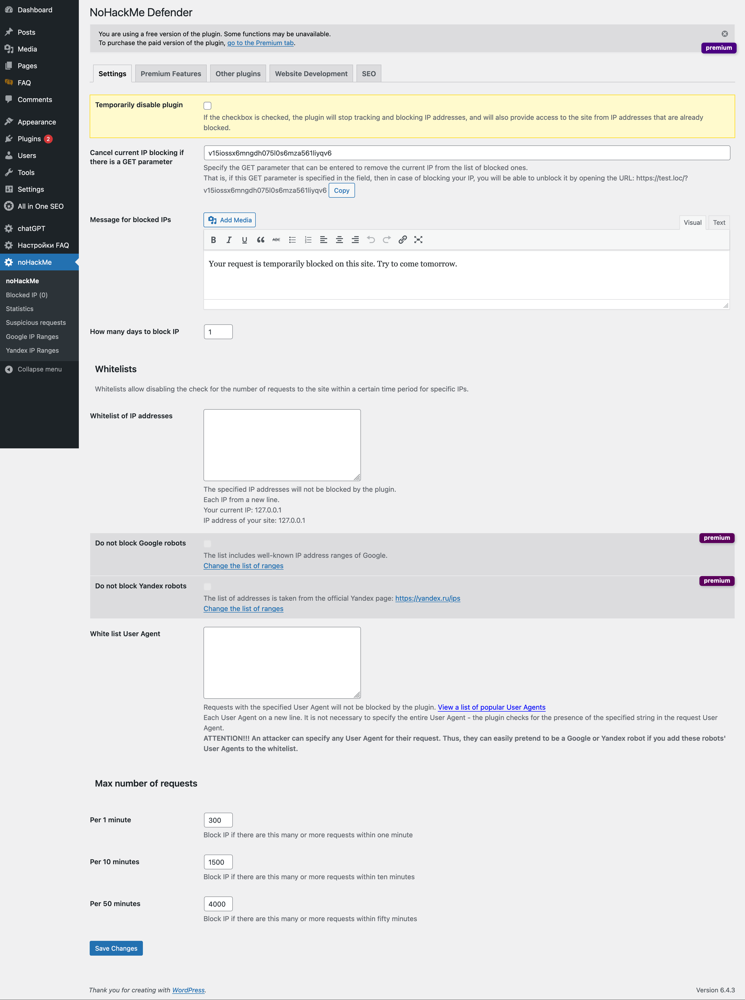
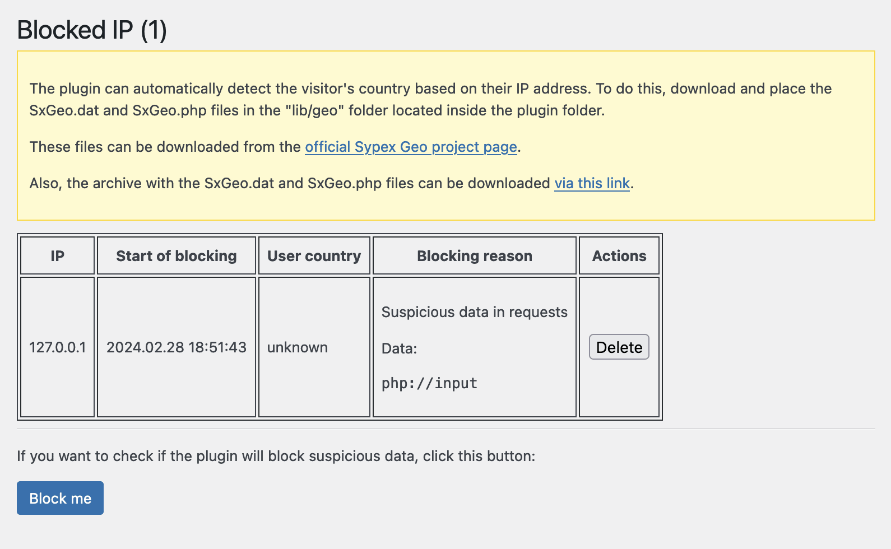
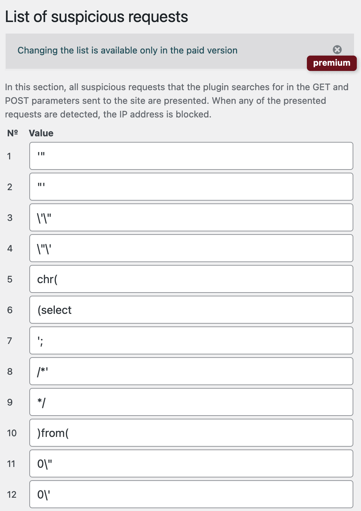
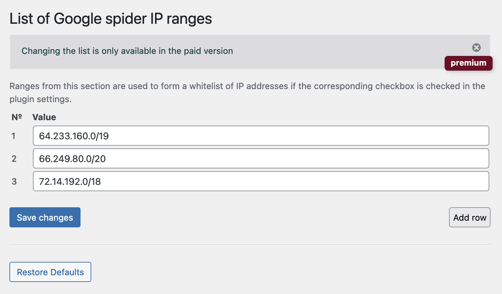
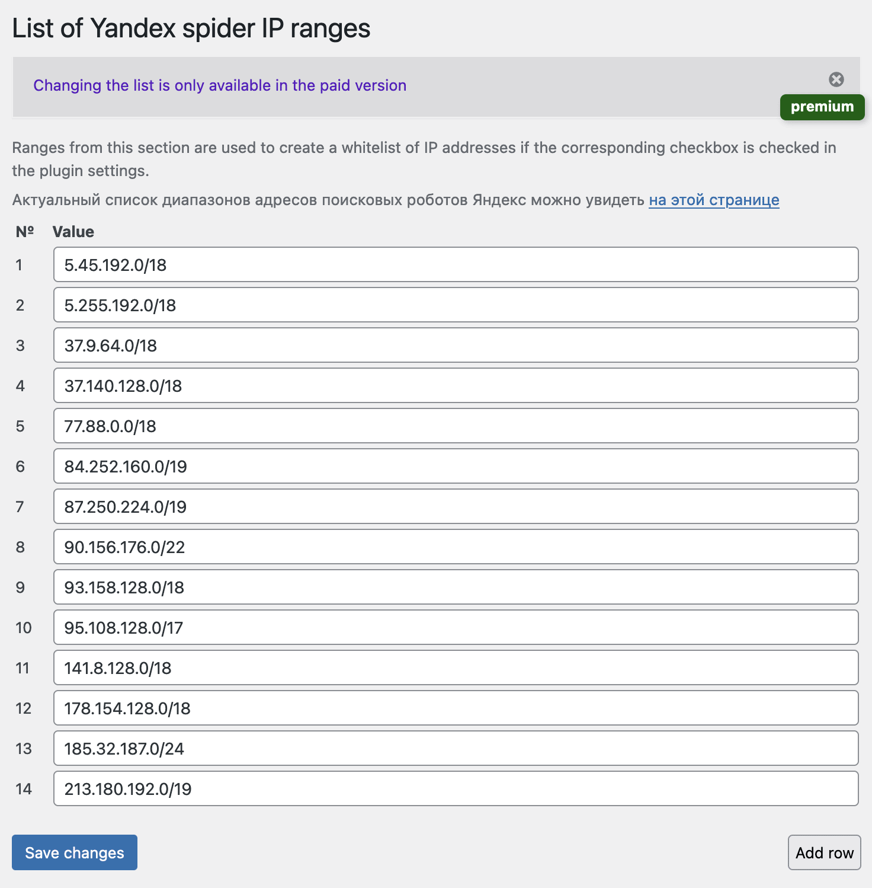
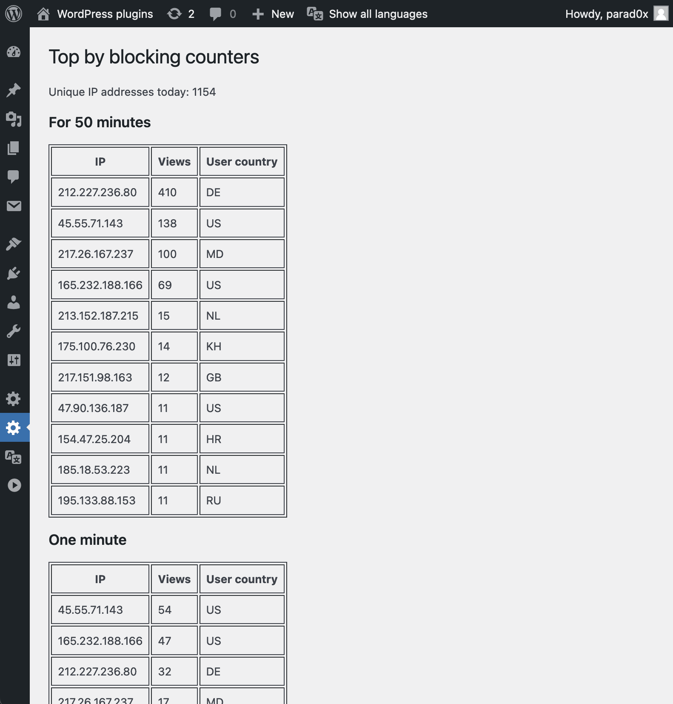

# NoHackMe Defender

A WordPress security plugin that blocks IP addresses after suspicious requests, sensitive-path scans, repeated login attempts, and excessive request rates.

- [WordPress.org plugin page](https://wordpress.org/plugins/nohackme-defender/)
- [Live demo and plugin guide](https://needtome.com/nohackme/)
- Current source version: **1.1.9**; requires WordPress 6.0+ and PHP 7.4+.

Install it from the WordPress Plugins screen or upload the plugin ZIP from WordPress.org. Review the plugin documentation and the access recovery instructions before enabling protection on a site.

## Screenshots

### Plugin settings and protection options

### Suspicious request rules

### Yandex IP range settings

### Blocked IP addresses

### Google IP range settings

### Request statistics

## Custom development and support

Custom WordPress plugin and website development is available at **$30/hour**. See [NeedToMe](https://needtome.com/) to get in touch.

Support further plugin development via [DonationAlerts](https://www.donationalerts.com/r/needtome) or [Patreon](https://patreon.com/needtome).

## License

GPL-2.0-or-later. See [LICENSE](LICENSE).
